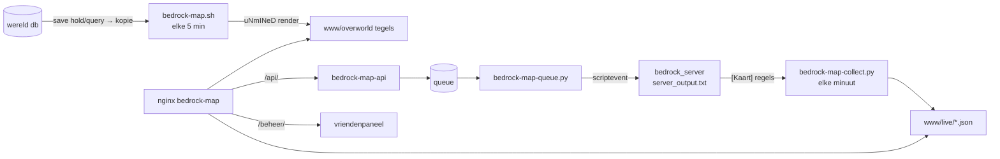

# Bedrock-kaart (mc.benjaminhashi.nl)

> [!note] Sinds 2026-10-31
> De kaartsite (nginx-unprivileged, poort 8080) en de kaart-API draaien in k3s, namespace `mc`, op ClusterIP 10.43.100.50; renderen en de collector zijn CronJobs. Bestanden blijven in `/srv/docker/bedrock-map`. → [[Minecraft op k3s]]

Live webkaart + statistieken van de Minecraft-wereld op [[mc.benjaminhashi.nl]]. Gebouwd door Claude vanaf 2026-10-13.

## Onderdelen

| Deel | Wat | Notitie |
|---|---|---|
| `bedrock-map` (nginx:1.27-alpine) | serveert `www/`, gzip 9, proxy `/api/` en `/beheer/` | — |
| `bedrock-map-api` (python, read-only, uid 1000) | warps toevoegen/verwijderen/terugzetten, 6 acties/min/IP, geen login | [[bedrock-map-queue.py]] |
| `www/index.html` + `live.js` + `stats.js` | kaart-UI (OpenLayers van uNmINeD), lagen, ranglijst | [[Stats en ranglijst]] |
| render | [[bedrock-map.sh]] met [[uNmINeD]] | |
| live data | [[Kaart-collector]] → `www/live/*.json` | |
| mijnhoogte | [[Mijnhoogte en ertsscan]] → `live/mijn.json` | |

## Functies op de kaart
- Alleen overworld (grotten/Nether-lagen weggehaald op verzoek), achtergrond "rustig water" (eigenaar: perfect, niet veranderen).
- Live spelers, warps (incl. zoeken, prullenbak/herstel), vaste markers (Winkel & Bank, records, winkels).
- Lagen: Heatmap, Biomes, Bouwen, Doden, Routes; afstand meten (lopen/rennen/paard/elytra, via Nether /8).
- Serverstatus-box (uit `live/server.json` van de [[vriendenpaneel-worker.py]]) + "Verbinden: minecraft.benjaminhashi.nl · 19132".
- Minecraft-thema (font Monocraft), mobiel compact, laadscherm, "kaart N min geleden bijgewerkt".

## Werkmap
`~/apps/map-work`: wereldkopie, JSON-state, `*.voor-*.{js,html,py}` = backups vóór elke wijziging (makkelijk terugdraaien).

Backup: [[app-backups.sh]] (kleine-apps, zonder tegels). Zie [[Bedrock-server]].
