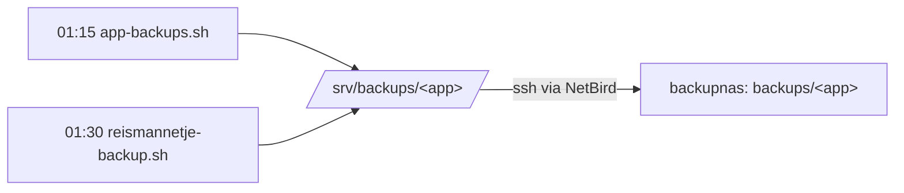

# Backup-strategie

> [!note] Sinds 2026-10-31
> Erbij: backup `k3s` (Secrets, sleutels, clusterdatabase). Reismannetje-data komt nu uit `/srv/k8s/reismannetje/data`. Terugvalmateriaal van de migratie: `/srv/backups/archief-voor-k3s-20261031.tar.gz`. → [[k3s-onderhoud]]

Elke nacht, per app een eigen script, steeds hetzelfde patroon: **consistente dump → tar.gz → 30 dagelijks + ±6 maandelijks lokaal → laatste 30 op de NAS**.

| Script | Apps |
|---|---|
| [[app-backups.sh]] | n8n, netbird, calibre-web, traefik, crowdsec, kleine-apps, bedrock, server |
| [[reismannetje-backup.sh]] | Reismannetje (DB, uploads, tickets, VAPID) |

- Databases altijd consistent: `pg_dump`, `mysqldump --single-transaction`, SQLite online backup + `integrity_check`, Bedrock via save hold.
- NAS-verbinding: SSH-sleutel `~/.config/nas-check/id_ed25519` naar `Jamaal@100.109.137.157`, vereist de policy VPS ↔ NAS ([[NetBird ACL en groepen]]).
- Controle: Reismannetje-backup-leeftijd via [[NAS app-check]]; logs in `/var/log/*-backup*.log`.
- Daarnaast: losse "voor-wijziging"-backups in [[srv-backups]] en [[Wereldbackups]].

Lokaal: [[srv-backups]]. Extern: [[backupnas (Synology)]].
