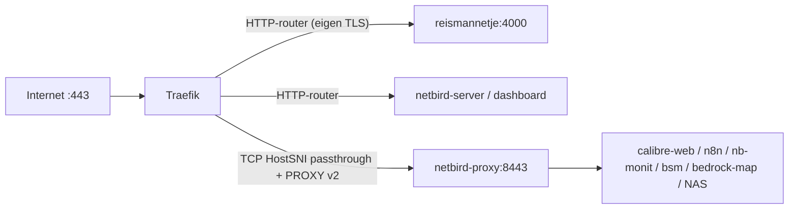

# Traefik

> [!note] Sinds 2026-10-31
> Routes naar k3s via vaste ClusterIP's (reismannetje 10.43.100.40, test .41, mc-netbird .50), met retry-middleware `k8s-deploy-retry` en `serversTransport k8s-snel` (dial-timeout 2 s). Nieuwe route reismannetje-test.benjaminhashi.nl (basic auth). Het access-log wordt eindelijk geroteerd (SELinux-label `var_log_t`). → [[Reismannetje op k3s]]

**De voordeur van de server** (sinds 2026-10-12; daarvoor Caddy, gearchiveerd in `/srv/archive/caddy-20261012`). Image `traefik:v3` (3.7), poorten 80/443.

## Bestanden
- `traefik.yml` — statisch: entrypoints `web` (→ redirect https) en `websecure` (timeouts 0 voor lange NetBird-streams), ACME http-01 resolver `le`, file provider, plugin `crowdsec-bouncer` v1.7.1, JSON-accesslog.
- `dynamic/sites.yml` — sites die Traefik zelf afhandelt: [[reismannetje.nl]] (+www, + oud [[vakantieplanner.benjaminhashi.nl]]), [[benjaminhashi.nl]] (+www), [[books-download.benjaminhashi.nl]].
- `dynamic/netbird.yml` — [[netbird.benjaminhashi.nl]] (gRPC h2c, relay/ws/api/oauth2, dashboard) + **TCP-passthrough** naar de [[NetBird reverse proxy]] + speciale regels voor [[mc.benjaminhashi.nl]].
- `dynamic/middlewares.yml` (600) — `crowdsec`, `secure-headers`, `compress` (zstd/br/gzip) → keten **`site-default`**.
- `logs/access.log` — gelezen door [[CrowdSec]]; logrotate 14 dagen.
- Volume `traefik_traefik_certs` → [[Certificaten (Let's Encrypt)]].
- Wijzigingen in `dynamic/` worden live herladen (watch), geen herstart nodig.

## Twee routes naar een app

1. **Direct** (Traefik termineert TLS, `site-default` met [[CrowdSec]]): reismannetje.nl, benjaminhashi.nl, netbird., books-download.
2. **Passthrough** naar de NetBird-proxy (die zelf TLS, SSO, geo en CrowdSec doet): [[books.benjaminhashi.nl]], [[n8n.benjaminhashi.nl]], [[monitor.benjaminhashi.nl]], [[bsm.benjaminhashi.nl]], [[nas.benjaminhashi.nl]], [[mc.benjaminhashi.nl]], `*.proxy.benjaminhashi.nl`.

## Speciaal: mc voor NetBird-peers
TCP-router `mc-proxy` = `HostSNI(mc) && !ClientIP(100.109.0.0/16)` (prio 1000) → proxy; HTTP-router `mc-netbird` = `HostRegexp(^mc…$) && ClientIP(100.109.0.0/16)` → `bedrock-map:80`. Moet `HostRegexp` zijn, anders claimt de HTTP-router de SNI. Reden: [[Geo-blokkade]].

## Regels
- **Geen HTTP/3 / 443-udp**: de NetBird-relayclient probeert QUIC op udp/443 en verliest dan de tunnel.
- Nieuwe site → router + service in `sites.yml`, en toevoegen aan SITES in [[ensure-apps-up.sh]], DOMAINS in [[n8n-daily-stats.sh]] en [[NAS app-check]].
- ACME wordt niet vanzelf opnieuw geprobeerd: na DNS-fix een echte config-wijziging doen (bijv. `tls: {certResolver: le}` toevoegen).

Backup: [[app-backups.sh]] (traefik). Zie ook [[Domeinen]], [[Firewall (iptables)]].
