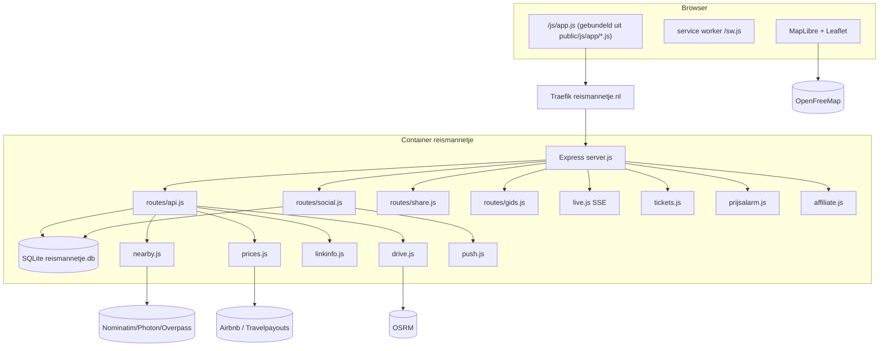

# Reismannetje architectuur

> [!note] Sinds 2026-10-31
> Runtime: k3s-Deployment (Recreate, uid 1000, read-only, NetworkPolicy) achter Docker-Traefik. → [[Reismannetje op k3s]]

- **Eén proces**, geen build-stap: `src/bundle.js` plakt de front-endbestanden aan elkaar tot één IIFE op `/js/app.js`.
- **Multi-tenant per groep**: elke API-call heeft header `X-Team`; alle tabellen hebben `team_id` → [[Groepen en chat]].
- **Realtime**: Server-Sent Events (`/api/live`) + polling-fallback → [[Planavond]].
- **Caches in SQLite**: prijzen 12 u, vluchten 6 u, plekken in de buurt 14 d, rijtijden 60 d.

Zie [[Reismannetje backend]], [[Reismannetje frontend]], [[Reismannetje database]], [[Externe diensten (Reismannetje)]].
